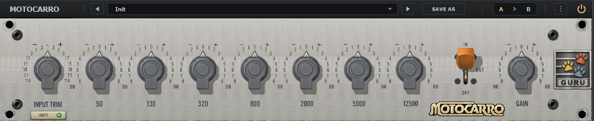

# MOTOCARRO

**Windows audio plugin · VST3 · AAX**



## Download

[**Download MOTOCARRO for Windows**](https://github.com/AntonioCalla27/MOTOCARRO/releases/latest/download/MOTOCARRO-installer.exe)

Version **0.2.0**. The Windows installer includes **VST3** and **AAX** formats.

[View the latest release](https://github.com/AntonioCalla27/MOTOCARRO/releases/latest)

## Installation

1. Download `MOTOCARRO-installer.exe` using the link above.
2. Close your audio application and run the installer.
3. Reopen your audio application and rescan its plugins if needed.
4. Find **MOTOCARRO** in the plugin browser.

## Verify your download

SHA-256 for the 0.2.0 Windows installer:

```text
2ccd8ef81fb7905fdbba25a7213e5ccecb25f7d8adfd0d2eb349c79872a6af47
```

## MultiVerse Prod.

[Website](https://multiverseprod.netlify.app/) · [Plugins](https://multiverseprod.netlify.app/plugins.html)
